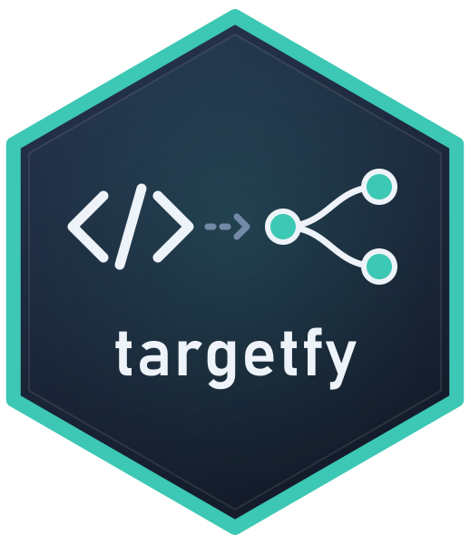
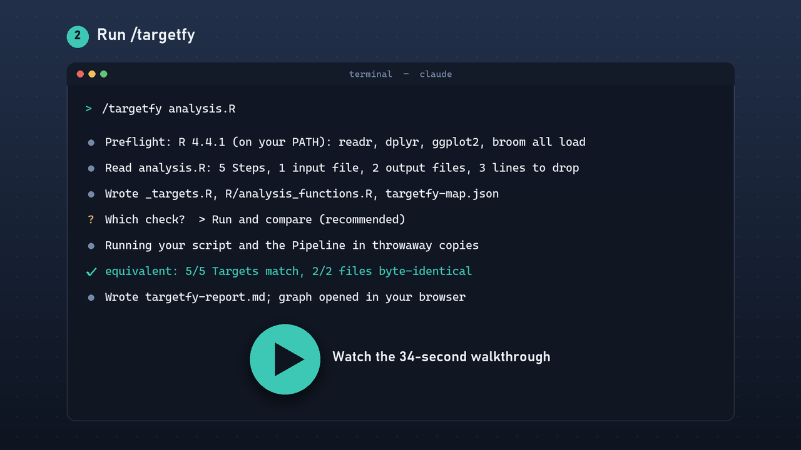

# targetfy 

A Claude Code skill that turns existing R scripts into an equivalent [`{targets}`](https://books.ropensci.org/targets/) pipeline, then offers optional Enhancements (dynamic branching, storage formats, parallel workers).

It never changes your files. It writes `_targets.R` (or `targets_<name>.R` when `_targets.R` already exists), a functions folder, a Step Map and a Conversion Report next to your scripts. A script sitting loose in Downloads or Desktop gets its own new folder, with a copy of the script and only the files it reads. A bundled R check then runs your scripts and the new Pipeline in throwaway copies and compares their results before the Conversion is accepted.

[](https://github.com/Athospd/targetfy/releases/download/v1.0.0/targetfy-walkthrough.mp4)

## Install

```sh
git clone https://github.com/Athospd/targetfy.git ~/.claude/skills/targetfy
```

Then, in Claude Code: `/targetfy`, or ask it to convert your R script(s) to targets.

Requires R >= 4.1 with `targets` (>= 1.12), `tarchetypes`, `callr` and `jsonlite`. targetfy never installs packages.

## Layout

| Path | What it is |
|---|---|
| `SKILL.md`, `references/` | the skill |
| `scripts/check.R` | the check that accepts or rejects a Conversion |
| `scripts/find-r.R` | picks the R installation where targetfy's and the scripts' packages all load |
| `vendor/targets-r-skill/` | pinned copy of [targets-r-skill](https://github.com/statzhero/targets-r-skill) by Ulrich Atz, used as the house style |
| `GLOSSARY.md`, `docs/` | vocabulary, design and decisions |
| `tests/` | the check's tests: `Rscript -e 'testthat::test_dir("tests/testthat")'` |
