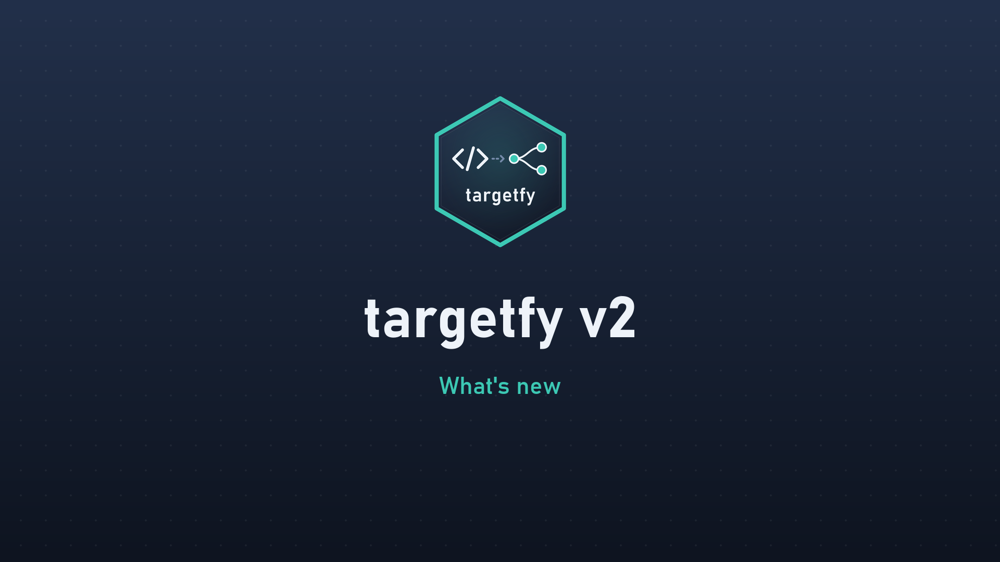

# targetfy 

A Claude Code skill that turns existing R scripts and R notebooks (`.qmd`, `.Rmd`, `.md`, R-kernel `.ipynb`) into an equivalent [`{targets}`](https://books.ropensci.org/targets/) pipeline, then offers optional Enhancements (dynamic branching, storage formats, parallel workers, rendering the document from the pipeline).

It never changes your files. It writes `_targets.R` (or `targets_<name>.R` when `_targets.R` already exists), a functions folder, a Step Map and a Conversion Report next to your scripts. A script sitting loose in Downloads or Desktop gets its own new folder, with a copy of the script and only the files it reads. A bundled R check then runs your scripts and the new Pipeline in throwaway copies and compares their results before the Conversion is accepted.

Scripts aren't always DAGs: a variable changed after something used it, a file read and then overwritten, a loop whose iterations feed each other. Before converting, a flow scan finds these patterns, so the Pipeline gets one Target per version, writes to a new path instead of overwriting its own input, and keeps stateful loops whole. The check also fails any Pipeline that is out of date right after it's built. It then changes each input file, one at a time, and checks that the pipeline reruns exactly the targets whose results change in your scripts. An input read but not tracked (a hidden dependency) fails the check, instead of going stale later. Code that isn't a step goes into the Pipeline's setup: functions defined in the script and sourced helpers into `tar_source()`; `set.seed()`, `rm()`/`gc()` and in-house packages into `tar_option_set()`; `options()` before the targets.

Scripts that render reports become `tar_render()`/`tar_quarto()` Targets, or `tar_render_rep()`/`tar_quarto_rep()` for one report per parameter set. Database and API reads, which targets can't see change, get `tar_change()` or `tar_age()`. Models that can't be saved as RDS (torch, keras) get a `tar_format()`, and web inputs get `format = "url"`. In an renv project, the check lists the packages `renv.lock` is missing.

[](https://youtu.be/QkxKGYAg51Q)

New to targetfy? The [34-second v1 walkthrough](https://www.youtube.com/watch?v=f4F8yNo_d8Y) shows a full run, from the R script to the Pipeline, its DAG and the report.

## Install

```sh
git clone https://github.com/Athospd/targetfy.git ~/.claude/skills/targetfy
```

Then, in Claude Code: `/targetfy`, or ask it to convert your R script(s) to targets.

Requires R >= 4.1 with `targets` (>= 1.12), `tarchetypes`, `callr` and `jsonlite`. targetfy never installs packages.

## Layout

| Path | What it is |
|---|---|
| `SKILL.md`, `references/` | the skill |
| `scripts/check.R` | the check that accepts or rejects a Conversion |
| `scripts/find-r.R` | picks the R installation where targetfy's and the scripts' packages all load |
| `scripts/read.R` | the flow scan, and the R code extracted from notebooks; runs nothing |
| `vendor/targets-r-skill/` | pinned copy of [targets-r-skill](https://github.com/statzhero/targets-r-skill) by Ulrich Atz, used as the house style |
| `GLOSSARY.md`, `docs/` | vocabulary, design and decisions |
| `tests/` | the check's tests: `Rscript -e 'testthat::test_dir("tests/testthat")'` |

## Changelog

Full notes for each version are on the [releases page](https://github.com/Athospd/targetfy/releases).

### [v2.1.0](https://github.com/Athospd/targetfy/releases/tag/v2.1.0) (2026-11-22)
- Scripts that render documents become `tar_render()`/`tar_quarto()` Targets, or `tar_render_rep()`/`tar_quarto_rep()` for a loop over parameters.
- Database and API reads are flagged, with `tar_change()` or `tar_age()`. The input-change check also changes local SQLite files.
- renv: the check lists the packages `renv.lock` doesn't record. New Enhancements: `tar_renv()` and `tar_github_actions()`.
- Now tested:
  - crew workers, which need `tar_hook_before()` for `options()`;
  - torch and keras, which need `tar_format()`;
  - `format = "url"`;
  - `tar_quarto_rep()`.
- A failed build names each failing Target and its error.

### [v2.0.0](https://github.com/Athospd/targetfy/releases/tag/v2.0.0) (2026-11-22)
- Notebooks as input: `.qmd`, `.Rmd`, `.md` and R-kernel `.ipynb`.
- Scripts that aren't DAGs: a flow scan finds:
  - variables changed after use, which become one Target per version;
  - files overwritten in place;
  - loops that carry state from one iteration to the next;
  - loops that could be branched.
- The Invalidation Check: changes each input file and compares what reruns, so hidden dependencies are caught.
- Pipeline setup from script code: `tar_source()`, and `tar_option_set()` for seed, memory and tolerated errors.
- Branching that fits the loop: `pattern = map()`, `tar_map()`, `tar_group_by()` or `tar_rep()`.
- Tested against [targets-live](https://github.com/Athospd/targets-live), a real teaching repository.

### [v1.0.0](https://github.com/Athospd/targetfy/releases/tag/v1.0.0) (2026-11-22)
- First release:
  - `.R` scripts become `_targets.R` plus one functions file per script;
  - the Equivalence Check runs both and compares results, with a Static Check fallback;
  - `find-r.R` picks an R installation where every package loads;
  - Enhancements: branching, storage formats, parallel workers.
